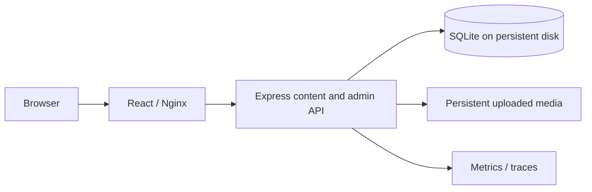

# Portfolio Architecture

This project contains only the personal portfolio and content studio. Its npm workspaces are `apps/portfolio` (`@portfolio/web`) and `packages/contracts` (`@portfolio/contracts`). Observability helpers are vendored locally under `packages/observability`; no imports cross the project root.

Vite/Nginx proxy `/api`, `/projects`, `/media` and `/sitemap.xml` to the API. Public APIs expose published localized content; session-authenticated owner/editor routes enforce CSRF/origin checks. Editors work on drafts; owner tools manage inbox, media, revisions and import/export. Server-rendered project pages preserve escaped text and metadata.

SQLite owns content, revision history, contact inbox, project passwords, aggregate analytics and sessions. Node.js 24 provides the database engine through `node:sqlite`. WAL mode, a busy timeout and immediate write transactions protect revision checks; JSON documents are serialized as validated text. Production media can live in a private S3-compatible object store; the media PVC remains the local fallback and migration path. JSON preview is explicit, loopback-only development storage, never a production fallback.

Helm/Argo/Jenkins and optional Terraform are self-contained here. The API runs as one replica with a `Recreate` strategy. A migration init container and the API mount the same retained `portfolio-database` PVC. The web tier may scale separately. SQLite needs reliable local filesystem locking; do not put its WAL database on NFS or run independent replicas against separate files. There is no database network service or database namespace.

See [Studio Setup](portfolio.md), [Deployment](deployment.md), and [Verification](verification.md).
