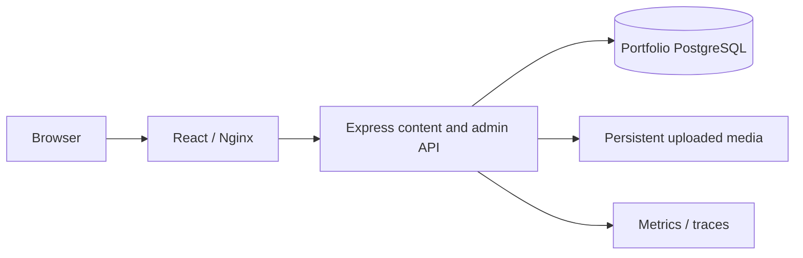

# Portfolio Architecture

This project contains only the personal portfolio and content studio. Its npm workspaces are `apps/portfolio` (`@portfolio/web`) and `packages/contracts` (`@portfolio/contracts`). Observability helpers are vendored locally under `packages/observability`; no imports cross the project root.

Vite/Nginx proxy `/api`, `/projects`, `/media` and `/sitemap.xml` to the API. Public APIs expose published localized content; session-authenticated owner/editor routes enforce CSRF/origin checks. Editors work on drafts; owner tools manage inbox, media, revisions and import/export. Server-rendered project pages preserve escaped text and metadata.

PostgreSQL owns content, revision history, contact inbox and sessions. Production media can live in a private S3-compatible object store; the media PVC remains the local-preview and rollback/migration path. File preview is explicit, loopback-only, single-process development storage; it is never a production fallback. Run the project's migrations before starting PostgreSQL mode.

Helm/Argo/Jenkins and optional Terraform are self-contained here. Native PostgreSQL uses port 5433; the legacy database chart is available under `deploy/helm/portfolio-db`. Never let both database modes accept writers simultaneously. Shared-host resources such as Traefik or Argo CD can be reused by an operator, but the application does not require the DailyPick checkout, database, Kafka, Elasticsearch, Stripe, or FinOps.

See [Studio Setup](portfolio.md), [Deployment](deployment.md), and [Verification](verification.md).
